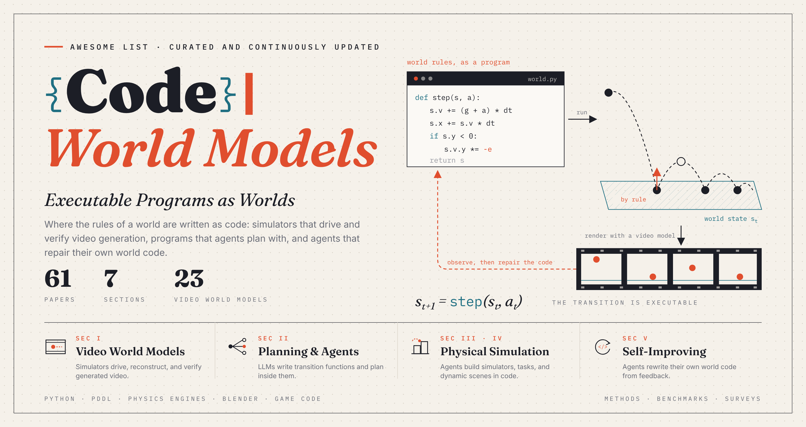

<div align="center">



[](https://awesome.re)
[](#content)
[](#)
[](#-contributing)

</div>

**Awesome Code World Models** is a curated and continuously updated collection of research on executable programs as world models, for planning, simulation, and video generation.

A code world model represents the state of a world and the rules by which it changes as a program that can be run: a Python transition function, a PDDL domain, a physics simulator script, a Blender or game-engine scene, or a procedural generator. Compared with a purely neural world model, such a representation is inspectable, editable, and checkable by execution, and it can encode long-horizon rules, object permanence, and conservation laws exactly. The cost is that someone must write the program; the recent shift is that coding agents can now write, run, and repair these programs themselves.

Two research lines are converging here. In agents and planning, [WorldCoder [Hao Tang et al., '24]](https://arxiv.org/abs/2402.12275) and [GIF-MCTS [Nicola Dainese et al., '24]](https://arxiv.org/abs/2405.15383) showed that an LLM can build a usable world model by writing and refining code from interaction, and [CWM [FAIR CodeGen team, '25]](https://arxiv.org/abs/2510.02387) trained a code LLM on execution traces so that it models program execution itself. In video generation, [GPT4Motion [Jiaxi Lv et al., '23]](https://arxiv.org/abs/2311.12631) and [PhysGen [Shaowei Liu et al., '24]](https://arxiv.org/abs/2409.18964) drove video synthesis with scripted physics, and [Code World Model [Yiwen Chen et al., '26]](https://arxiv.org/abs/2608.25927) proposes a division of labor in which a coding agent maintains the world state in code while a video model renders appearance and fine motion.

**Inclusion rule.** A paper is listed only if an executable program represents how a world evolves over time: its state and the rules that change it. Code that only describes a static scene, a reward, or a layout is out of scope (a few representative works are listed under [Related but Out of Scope](#related-but-out-of-scope)), as are purely neural world models (see [Related Awesome Lists](#related-awesome-lists)). Each paper appears once, in its primary section; secondary topics are marked with tags (`Video`, `Agent`, `RSI`, `Benchmark`, `3D`, `Embodied`).

This project is curated and maintained by [Ping Liu](https://pinglmlcv.github.io/pingliu264/) ([University of Nevada, Reno](https://www.unr.edu/cse)). If you believe additional works should be included, please email <pingl@unr.edu> or [raise an issue](../../issues).

## News

- **[2026.10]** 🎉 Repository created with **62 papers**.

## Content

---

- [1. 🎬 Code for Video World Models](#1--code-for-video-world-models)
  - [1.1 Simulation-Conditioned Video Generation](#11-simulation-conditioned-video-generation)
  - [1.2 Video-to-Simulation](#12-video-to-simulation)
  - [1.3 Code-Rendered Video](#13-code-rendered-video)
  - [1.4 Code-Based Verification of Video](#14-code-based-verification-of-video)
- [2. 🧭 Code World Models for Planning and Agents](#2--code-world-models-for-planning-and-agents)
- [3. 🤖 Code for Physical and Embodied Simulation](#3--code-for-physical-and-embodied-simulation)
- [4. 🧊 Code for Dynamic 3D/4D Scenes](#4--code-for-dynamic-3d4d-scenes)
- [5. ♻️ Self-Improving Code World Models](#5--self-improving-code-world-models)
- [6. 📊 Benchmarks and Datasets](#6--benchmarks-and-datasets)
- [7. 📚 Surveys](#7--surveys)
- [Related but Out of Scope](#related-but-out-of-scope)
- [Related Awesome Lists](#related-awesome-lists)
- [Contributing](#-contributing)

---

## 1. 🎬 Code for Video World Models

### 1.1 Simulation-Conditioned Video Generation

A program or physics simulator evolves the world state, and a video generator renders it.

-  🔥 **Agentic Physics-Grounded Video Generation via Memory-Augmented In-Context Reasoning** (Xikang Guan, Shaocong Yang, Yanqi Bao, Can Wang, Zheng Gu, Zhengqing Chen, Kai Chen, Jing Huo, Yang Gao) · [📄 Paper](https://arxiv.org/abs/2610.23677) · [💻 Code](https://xxkkxxx.github.io/PhysRepair-Website/) · `Agent`
-  🔥 **Code World Model: Coding Agent as World Brain** (Yiwen Chen, Guosheng Lin, Chi Zhang) · [📄 Paper](https://arxiv.org/abs/2608.25927) · [💻 Code](https://github.com/buaacyw/code-world-model) · `Agent`
-  🔥 **PhysAgent: Reflective Agentic Physics Control for Physically Plausible Video Generation** (Qirui Li, Jinkun Hao, Yibo Li, Ran Yi, Paul L. Rosin, Yu-Kun Lai) · [📄 Paper](https://arxiv.org/abs/2607.16355) · `Agent`
-  🔥 **Physical Simulator In-the-Loop Video Generation** (Lin Geng Foo, Mark He Huang, Alexandros Lattas, Stylianos Moschoglou, Thabo Beeler, Christian Theobalt) · [📄 Paper](https://arxiv.org/abs/2603.06408)
-  🔥 **RealWonder: Real-Time Physical Action-Conditioned Video Generation** (Wei Liu, Ziyu Chen, Zizhang Li, Yue Wang, Hong-Xing Yu, Jiajun Wu) · [📄 Paper](https://arxiv.org/abs/2603.05449)
-  🔥 **MoReGen: Multi-Agent Motion-Reasoning Engine for Code-based Text-to-Video Synthesis** (Xiangyu Bai, Bishoy Galoaa, Shayda Moezzi, He Liang, Utsav Nandi, Yuhang He, Sarah Ostadabbas) · [📄 Paper](https://arxiv.org/abs/2512.04221) · [💻 Code](https://github.com/ostadabbas/MoReGen-Multi-Agent-Motion-Reasoning-Engine) · `Agent`
-  **PhysCtrl: Generative Physics for Controllable and Physics-Grounded Video Generation** (Chen Wang, Chuhao Chen, Yiming Huang, Zhiyang Dou, Yuan Liu, Jiatao Gu, Lingjie Liu) · [📄 Paper](https://arxiv.org/abs/2509.20358)
-  **WonderPlay: Dynamic 3D Scene Generation from a Single Image and Actions** (Zizhang Li, Hong-Xing Yu, Wei Liu, Yin Yang, Charles Herrmann, Gordon Wetzstein, Jiajun Wu) · [📄 Paper](https://arxiv.org/abs/2505.18151)
-  **PhysGen3D: Crafting a Miniature Interactive World from a Single Image** (Boyuan Chen, Hanxiao Jiang, Shaowei Liu, Saurabh Gupta, Yunzhu Li, Hao Zhao, Shenlong Wang) · [📄 Paper](https://arxiv.org/abs/2503.20746)
-  **PhysAnimator: Physics-Guided Generative Cartoon Animation** (Tianyi Xie, Yiwei Zhao, Ying Jiang, Chenfanfu Jiang) · [📄 Paper](https://arxiv.org/abs/2501.16550)
-  **PhysMotion: Physics-Grounded Dynamics from a Single Image** (Xiyang Tan, Ying Jiang, Xuan Li, Zeshun Zong, Tianyi Xie, Yin Yang, Chenfanfu Jiang) · [📄 Paper](https://arxiv.org/abs/2411.17189)
-  **PhysGen: Rigid-Body Physics-Grounded Image-to-Video Generation** (Shaowei Liu, Zhongzheng Ren, Saurabh Gupta, Shenlong Wang) · [📄 Paper](https://arxiv.org/abs/2409.18964) · [💻 Code](https://github.com/stevenlsw/physgen)
-  **MotionCraft: Physics-based Zero-Shot Video Generation** (Luca Savant Aira, Antonio Montanaro, Emanuele Aiello, Diego Valsesia, Enrico Magli) · [📄 Paper](https://arxiv.org/abs/2405.13557)
-  **GPT4Motion: Scripting Physical Motions in Text-to-Video Generation via Blender-Oriented GPT Planning** (Jiaxi Lv, Yi Huang, Mingfu Yan, Jiancheng Huang, Jianzhuang Liu, Yifan Liu, Yafei Wen, Xiaoxin Chen, Shifeng Chen) · [📄 Paper](https://arxiv.org/abs/2311.12631) · [💻 Code](https://github.com/jiaxilv/GPT4Motion) · `3D`

### 1.2 Video-to-Simulation

An agent recovers an executable simulation or program that explains an observed video.

-  🔥 **4DCodeBench: Benchmarking Agents on Inverse Graphics of Dynamic Scenes** (Ruihong Shen, Žiga Kovačič, Peter Kulits, Xingrui Wang, Zizhang Li, Joshua B. Tenenbaum, Alan Yuille, Jieneng Chen, Jiajun Wu) · [📄 Paper](https://arxiv.org/abs/2610.03715) · [💻 Code](https://github.com/4DCodeBench/4DCodeBench) · `Benchmark` `3D`
-  🔥 **Code as Worlds: Agentic Discovery of Executable World Representations for Physical Reasoning** (Hanyang Wang, Yimo Cai, Weiliang Chen, Jiawei Chi, Haowen Sun, Qiyu Dai, Yi-Hsin Hung, Xingzhuo Guo, Jinshan Ren, Runmao Yao, Ziwei Liu, Mingsheng Long, Yueqi Duan, Jun Gao, Jiangran Lyu, Fangfu Liu, Jialong Wu) · [📄 Paper](https://arxiv.org/abs/2608.27549) · `Agent` `RSI`
-  🔥 **MPMWorlds: Material-Point-Method Simulations for Inferring and Extrapolating Physical Dynamics** (Žiga Kovačič, Kevin Ellis) · [📄 Paper](https://arxiv.org/abs/2606.01538) · `Benchmark`
-  🔥 **VisPhyWorld: Probing Physical Reasoning via Code-Driven Video Reconstruction** (Jiarong Liang, Max Ku, Ka-Hei Hui, Ping Nie, Wenhu Chen) · [📄 Paper](https://arxiv.org/abs/2602.13294) · [💻 Code](https://github.com/TIGER-AI-Lab/VisPhyWorld) · `Benchmark`
-  **Programmatic Video Prediction Using Large Language Models** (Hao Tang, Kevin Ellis, Suhas Lohit, Michael J. Jones, Moitreya Chatterjee) · [📄 Paper](https://arxiv.org/abs/2505.14948)
-  **Video2Game: Real-time, Interactive, Realistic and Browser-Compatible Environment from a Single Video** (Hongchi Xia, Zhi-Hao Lin, Wei-Chiu Ma, Shenlong Wang) · [📄 Paper](https://arxiv.org/abs/2404.09833) · `3D`

### 1.3 Code-Rendered Video

An agent writes animation or scene code whose execution produces the video.

-  **Code2Video: A Code-centric Paradigm for Educational Video Generation** (Yanzhe Chen, Kevin Qinghong Lin, Mike Zheng Shou) · [📄 Paper](https://arxiv.org/abs/2510.01174) · [💻 Code](https://github.com/showlab/Code2Video) · `Agent`
-  **Kubrick: Multimodal Agent Collaborations for Synthetic Video Generation** (Liu He, Yizhi Song, Hejun Huang, Pinxin Liu, Yunlong Tang, Daniel Aliaga, Xin Zhou) · [📄 Paper](https://arxiv.org/abs/2408.10453) · `Agent` `3D`

### 1.4 Code-Based Verification of Video

Simulators or executable checks evaluate the physical consistency of generated video.

-  🔥 **RigidBench: Evaluating Rigid-Body Physics in Video Generation Models** (Swarnim Jain, Shangzhe Wu) · [📄 Paper](https://arxiv.org/abs/2608.15555) · `Benchmark`
-  🔥 **GAUGE: A Measurement-Grounded Benchmark for Physical Fidelity in Simulation Engines and Video World Models** (Shuai Wang, Yaxin Feng, Xuekun Jiang, Shihan Tian, Ningyu Yan, Xing Shen, Chaoyang Lyu, Hui Wang, Yunsong Zhou, Hanqing Wang, Jiangmiao Pang, Yang Xiang, et al.) · [📄 Paper](https://arxiv.org/abs/2608.05948) · `Benchmark`

## 2. 🧭 Code World Models for Planning and Agents

The model writes the transition function or domain model (Python, PDDL, probabilistic programs) and plans with it, or is trained to model program execution.

-  🔥 **VisualPatchWorld: Code World Models as Latent Structured Representations for Planning** (Jiaxin Bai, Jiaxuan Xiong) · [📄 Paper](https://arxiv.org/abs/2607.25236) · [💻 Code](https://github.com/HKBU-KnowComp/VisualPatchWorld)
-  🔥 **Code2World: A GUI World Model via Renderable Code Generation** (Yuhao Zheng, Li'an Zhong, Yi Wang, Rui Dai, Kaikui Liu, Xiangxiang Chu, Linyuan Lv, Philip Torr, Kevin Qinghong Lin) · [📄 Paper](https://arxiv.org/abs/2602.09856) · [💻 Code](https://github.com/AMAP-ML/Code2World)
-  🔥 **Learning Abstractions for Hierarchical Planning in Program-Synthesis Agents** (Zergham Ahmed, Kazuki Irie, Joshua B. Tenenbaum, Christopher J. Bates, Samuel J. Gershman) · [📄 Paper](https://arxiv.org/abs/2602.00929)
-  **Agent2World: Learning to Generate Symbolic World Models via Adaptive Multi-Agent Feedback** (Mengkang Hu, Bowei Xia, Yuran Wu, Ailing Yu, Yude Zou, Qiguang Chen, Shijian Wang, Jiarui Jin, Kexin Li, Wenxiang Jiao, Yuan Lu, Ping Luo) · [📄 Paper](https://arxiv.org/abs/2512.22336)
-  🔥 **One Life to Learn: Inferring Symbolic World Models for Stochastic Environments from Unguided Exploration** (Zaid Khan, Archiki Prasad, Elias Stengel-Eskin, Jaemin Cho, Mohit Bansal) · [📄 Paper](https://arxiv.org/abs/2510.12088)
-  🔥 **Code World Models for General Game Playing** (Wolfgang Lehrach, Daniel Hennes, Miguel Lazaro-Gredilla, Xinghua Lou, Carter Wendelken, Zun Li, Antoine Dedieu, Jordi Grau-Moya, Marc Lanctot, Atil Iscen, John Schultz, Marcus Chiam, et al.) · [📄 Paper](https://arxiv.org/abs/2510.04542)
-  **CWM: An Open-Weights LLM for Research on Code Generation with World Models** (FAIR CodeGen team, Jade Copet, Quentin Carbonneaux, Gal Cohen, Jonas Gehring, Jacob Kahn, Jannik Kossen, Felix Kreuk, Emily McMilin, Michel Meyer, Yuxiang Wei, David Zhang, et al.) · [📄 Paper](https://arxiv.org/abs/2510.02387)
-  **PoE-World: Compositional World Modeling with Products of Programmatic Experts** (Wasu Top Piriyakulkij, Yichao Liang, Hao Tang, Adrian Weller, Marta Kryven, Kevin Ellis) · [📄 Paper](https://arxiv.org/abs/2505.10819)
-  **LLM-Guided Probabilistic Program Induction for POMDP Model Estimation** (Aidan Curtis, Hao Tang, Thiago Veloso, Kevin Ellis, Joshua Tenenbaum, Tomás Lozano-Pérez, Leslie Pack Kaelbling) · [📄 Paper](https://arxiv.org/abs/2505.02216)
-  **WALL-E 2.0: World Alignment by NeuroSymbolic Learning improves World Model-based LLM Agents** (Siyu Zhou, Tianyi Zhou, Yijun Yang, Guodong Long, Deheng Ye, Jing Jiang, Chengqi Zhang) · [📄 Paper](https://arxiv.org/abs/2504.15785)
-  🔥 **Synthesizing World Models for Bilevel Planning** (Zergham Ahmed, Joshua B. Tenenbaum, Christopher J. Bates, Samuel J. Gershman) · [📄 Paper](https://arxiv.org/abs/2503.20124)
-  **Generating Symbolic World Models via Test-time Scaling of Large Language Models** (Zhouliang Yu, Yuhuan Yuan, Tim Z. Xiao, Fuxiang Frank Xia, Jie Fu, Ge Zhang, Ge Lin, Weiyang Liu) · [📄 Paper](https://arxiv.org/abs/2502.04728)
-  **Generating Code World Models with Large Language Models Guided by Monte Carlo Tree Search** (Nicola Dainese, Matteo Merler, Minttu Alakuijala, Pekka Marttinen) · [📄 Paper](https://arxiv.org/abs/2405.15383) · [💻 Code](https://github.com/nicoladainese96/code-world-models) · `Benchmark`
-  **WorldCoder, a Model-Based LLM Agent: Building World Models by Writing Code and Interacting with the Environment** (Hao Tang, Darren Key, Kevin Ellis) · [📄 Paper](https://arxiv.org/abs/2402.12275) · `RSI`
-  **Leveraging Pre-trained Large Language Models to Construct and Utilize World Models for Model-based Task Planning** (Lin Guan, Karthik Valmeekam, Sarath Sreedharan, Subbarao Kambhampati) · [📄 Paper](https://arxiv.org/abs/2305.14909) · [💻 Code](https://github.com/GuanSuns/LLMs-World-Models-for-Planning)

## 3. 🤖 Code for Physical and Embodied Simulation

LLMs and agents write simulators, simulated tasks, and articulated assets whose dynamics are defined in code.

-  🔥 **ChronoAgentic: A Code-based Multi-Agent World Simulator for Physically Grounded Simulation Construction** (Hongyu Wang, Jingquan Wang, Ashvin Anilkumar, Bocheng Zou, Radu Serban, Dan Negrut) · [📄 Paper](https://arxiv.org/abs/2605.14398) · `Agent`
-  **Video2Policy: Scaling up Manipulation Tasks in Simulation through Internet Videos** (Weirui Ye, Fangchen Liu, Zheng Ding, Yang Gao, Oleh Rybkin, Pieter Abbeel) · [📄 Paper](https://arxiv.org/abs/2502.09886) · `Video`
-  **Articulate-Anything: Automatic Modeling of Articulated Objects via a Vision-Language Foundation Model** (Long Le, Jason Xie, William Liang, Hung-Ju Wang, Yue Yang, Yecheng Jason Ma, Kyle Vedder, Arjun Krishna, Dinesh Jayaraman, Eric Eaton) · [📄 Paper](https://arxiv.org/abs/2410.13882) · [💻 Code](https://github.com/vlongle/articulate-anything) · `3D`
-  **GenSim2: Scaling Robot Data Generation with Multi-modal and Reasoning LLMs** (Pu Hua, Minghuan Liu, Annabella Macaluso, Yunfeng Lin, Weinan Zhang, Huazhe Xu, Lirui Wang) · [📄 Paper](https://arxiv.org/abs/2410.03645) · [💻 Code](https://github.com/GenSim2/GenSim2)
-  **Real2Code: Reconstruct Articulated Objects via Code Generation** (Zhao Mandi, Yijia Weng, Dominik Bauer, Shuran Song) · [📄 Paper](https://arxiv.org/abs/2406.08474) · [💻 Code](https://github.com/MandiZhao/real2code) · `3D`
-  **RoboGen: Towards Unleashing Infinite Data for Automated Robot Learning via Generative Simulation** (Yufei Wang, Zhou Xian, Feng Chen, Tsun-Hsuan Wang, Yian Wang, Katerina Fragkiadaki, Zackory Erickson, David Held, Chuang Gan) · [📄 Paper](https://arxiv.org/abs/2311.01455) · [💻 Code](https://github.com/Genesis-Embodied-AI/RoboGen)
-  **Gen2Sim: Scaling up Robot Learning in Simulation with Generative Models** (Pushkal Katara, Zhou Xian, Katerina Fragkiadaki) · [📄 Paper](https://arxiv.org/abs/2310.18308)
-  **GenSim: Generating Robotic Simulation Tasks via Large Language Models** (Lirui Wang, Yiyang Ling, Zhecheng Yuan, Mohit Shridhar, Chen Bao, Yuzhe Qin, Bailin Wang, Huazhe Xu, Xiaolong Wang) · [📄 Paper](https://arxiv.org/abs/2310.01361) · [💻 Code](https://github.com/liruiw/GenSim)

## 4. 🧊 Code for Dynamic 3D/4D Scenes

Dynamic scenes whose motion and physics are specified as programs.

-  🔥 **SimWorlds: A Multi-Agent System for Dynamic 3D Scene Creation** (Chunjiang Liu, Xiaoyuan Wang, Haoyu Chen, Yizhou Zhao, Ming-Hsuan Yang, László A. Jeni) · [📄 Paper](https://arxiv.org/abs/2607.01766) · `Agent`
-  🔥 **Code2Worlds: Empowering Coding LLMs for 4D World Generation** (Yi Zhang, Yunshuang Wang, Zeyu Zhang, Hao Tang) · [📄 Paper](https://arxiv.org/abs/2602.11757) · `Video`
-  🔥 **Training and Benchmarking Code Generation for Physics-Inspired Animations** (Yanan Wang, Renxi Wang, Yongxin Wang, Xuezhi Liang, Fajri Koto, Timothy Baldwin, Xiaodan Liang, Haonan Li) · [📄 Paper](https://arxiv.org/abs/2602.10840) · `Benchmark` `Video`

## 5. ♻️ Self-Improving Code World Models

Agents that iteratively rewrite their own world or environment code from execution or visual feedback. General self-improving agents are covered by the lists in [Related Awesome Lists](#related-awesome-lists).

-  🔥 **Self-Evolving Coding Agents: From Digital Programs to Physical-World Intelligence** (Hongcheng Gao, Jingjing Zhou, Zelin Zheng, Shijia Ge, Jay Zhu, Yazhe Wang, Jianshu Zeng, Xuan Shangguan, Di Wu, Lingyu He, Zhiqi Jia, Sihang Wu, et al.) · [📄 Paper](https://arxiv.org/abs/2609.35432) · `Agent`
-  🔥 **SimWorld Studio: Automatic Environment Generation with Evolving Coding Agent for Embodied Agent Learning** (Haoqiang Kang, Xiaokang Ye, Yuhan Liu, Siddhant Hitesh Mantri, Lingjun Mao, James Fleming, Drishti Regmi, Lianhui Qin) · [📄 Paper](https://arxiv.org/abs/2605.09423) · `Embodied`
-  **Eurekaverse: Environment Curriculum Generation via Large Language Models** (William Liang, Sam Wang, Hung-Ju Wang, Osbert Bastani, Dinesh Jayaraman, Yecheng Jason Ma) · [📄 Paper](https://arxiv.org/abs/2411.01775) · [💻 Code](https://github.com/eureka-research/eurekaverse) · `Embodied`
-  **OMNI-EPIC: Open-endedness via Models of human Notions of Interestingness with Environments Programmed in Code** (Maxence Faldor, Jenny Zhang, Antoine Cully, Jeff Clune) · [📄 Paper](https://arxiv.org/abs/2405.15568) · [💻 Code](https://github.com/maxencefaldor/omni-epic) · `Embodied`

## 6. 📊 Benchmarks and Datasets

Benchmarks for writing world models or simulators as code. Video-specific benchmarks are kept under Section 1.

-  🔥 **WorldSolver: Can LLM Agents Simulate the Physical Dynamics via Solver Generation?** (Siru Jiang, Yongzhe Lyu, Shuo Lu, Yubin Wang, Yuxiang Zhang, Yue Liao, Bin Wang, Jian Liang, Tieniu Tan) · [📄 Paper](https://arxiv.org/abs/2610.08720) · [💻 Code](https://github.com/sirujiang/WorldSolver)
-  🔥 **PhysCodeBench: Benchmarking Physics-Aware Symbolic Simulation of 3D Scenes via Self-Corrective Multi-Agent Refinement** (Tianyidan Xie, Peiyu Wang, Hu Jiaxin, Yuyi Qian, Yuxuan Wang, Shenyi Wang, Rui Ma, Yanlun Peng, Lanjun Wang, Ying Tai, Jian Yang, Zili Yi) · [📄 Paper](https://arxiv.org/abs/2604.23580) · `3D`
-  **Text2World: Benchmarking Large Language Models for Symbolic World Model Generation** (Mengkang Hu, Tianxing Chen, Yude Zou, Yuheng Lei, Qiguang Chen, Ming Li, Yao Mu, Hongyuan Zhang, Wenqi Shao, Ping Luo) · [📄 Paper](https://arxiv.org/abs/2502.13092)
-  **SimBench: A Framework for Evaluating and Diagnosing LLM-Based Digital-Twin Generation for Multi-Physics Simulation** (Jingquan Wang, Andrew Negrut, Hongyu Wang, Harry Zhang, Dan Negrut) · [📄 Paper](https://arxiv.org/abs/2408.11987) · [💻 Code](https://github.com/uwsbel/simbench)
-  **ByteSized32: A Corpus and Challenge Task for Generating Task-Specific World Models Expressed as Text Games** (Ruoyao Wang, Graham Todd, Eric Yuan, Ziang Xiao, Marc-Alexandre Côté, Peter Jansen) · [📄 Paper](https://arxiv.org/abs/2305.14879) · [💻 Code](https://github.com/cognitiveailab/BYTESIZED32)

## 7. 📚 Surveys

-  🔥 **Agentic Environment Engineering for Large Language Models: A Survey of Environment Modeling, Synthesis, Evaluation, and Application** (Jiachun Li, Zhuoran Jin, Tianyi Men, Yupu Hao, Kejian Zhu, Lingshuai Wang, Dongqi Huang, Longxiang Wang, Shengjia Hua, Lu Wang, Jinshan Gao, Hongbang Yuan, et al.) · [📄 Paper](https://arxiv.org/abs/2606.12191)
-  **LLMs as Planning Formalizers: A Survey for Leveraging Large Language Models to Construct Automated Planning Models** (Marcus Tantakoun, Xiaodan Zhu, Christian Muise) · [📄 Paper](https://arxiv.org/abs/2503.18971)
-  **Exploring the Evolution of Physics Cognition in Video Generation: A Survey** (Minghui Lin, Xiang Wang, Yishan Wang, Shu Wang, Fengqi Dai, Pengxiang Ding, Cunxiang Wang, Zhengrong Zuo, Nong Sang, Siteng Huang, Donglin Wang) · [📄 Paper](https://arxiv.org/abs/2503.21765) · `Video`

---

## Related but Out of Scope

Influential work that uses code for rewards, static scenes, or layouts rather than for world dynamics.

-  **Eureka: Human-Level Reward Design via Coding Large Language Models** (Yecheng Jason Ma, William Liang, Guanzhi Wang, De-An Huang, Osbert Bastani, Dinesh Jayaraman, Yuke Zhu, Linxi Fan, Anima Anandkumar) · [📄 Paper](https://arxiv.org/abs/2310.12931) · [💻 Code](https://github.com/eureka-research/Eureka)
-  **Infinite Photorealistic Worlds using Procedural Generation** (Alexander Raistrick, Lahav Lipson, Zeyu Ma, Lingjie Mei, Mingzhe Wang, Yiming Zuo, Karhan Kayan, Hongyu Wen, Beining Han, Yihan Wang, Alejandro Newell, Hei Law, et al.) · [📄 Paper](https://arxiv.org/abs/2306.09310) · [💻 Code](https://github.com/princeton-vl/infinigen)
-  **SceneCraft: An LLM Agent for Synthesizing 3D Scene as Blender Code** (Ziniu Hu, Ahmet Iscen, Aashi Jain, Thomas Kipf, Yisong Yue, David A. Ross, Cordelia Schmid, Alireza Fathi) · [📄 Paper](https://arxiv.org/abs/2403.01248)
-  **LLM-grounded Video Diffusion Models** (Long Lian, Baifeng Shi, Adam Yala, Trevor Darrell, Boyi Li) · [📄 Paper](https://arxiv.org/abs/2309.17444) · [💻 Code](https://github.com/TonyLianLong/LLM-groundedVideoDiffusion)
-  **The Scene Language: Representing Scenes with Programs, Words, and Embeddings** (Yunzhi Zhang, Zizhang Li, Matt Zhou, Shangzhe Wu, Jiajun Wu) · [📄 Paper](https://arxiv.org/abs/2410.16770) · [💻 Code](https://github.com/zzyunzhi/scene-language)

## Related Awesome Lists

- [Awesome-World-Models](https://github.com/leofan90/Awesome-World-Models): world models for video generation, embodied AI, and autonomous driving.
- [Awesome-From-Video-Generation-to-World-Model](https://github.com/ziqihuangg/Awesome-From-Video-Generation-to-World-Model): video generation evolving toward world models.
- [Awesome-Self-Improving-Agents](https://github.com/selfimproving-agent/awesome-Self-Improving-Agents): self-improvement in foundation-model agents.
- [awesome-autoresearch](https://github.com/alvinreal/awesome-autoresearch): autonomous research and improvement loops.

---

## 🤝 Contributing

Pull requests are welcome. Please add each paper to its primary section in the format below, keeping the list in reverse chronological order:

```markdown
-  🔥 **Paper Title** (Author One, Author Two) · [📄 Paper](https://arxiv.org/abs/XXXX.XXXXX) · [💻 Code](https://github.com/owner/repo) · `Video`
```

Badge colors:  preprint,  vision conference,  machine learning venue,  journal,  other conference,  workshop. 🔥 marks papers from 2026. Tags mark secondary topics of a paper listed in another section.

---

## Star History

<p align="center">
<a href="https://star-history.com/#pinglmlcv/Awesome-Code-World-Models&Date">

</a>
</p>
